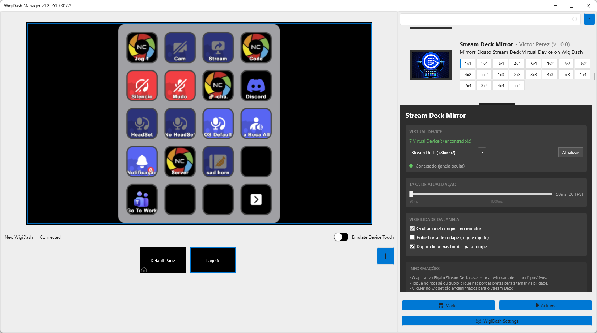
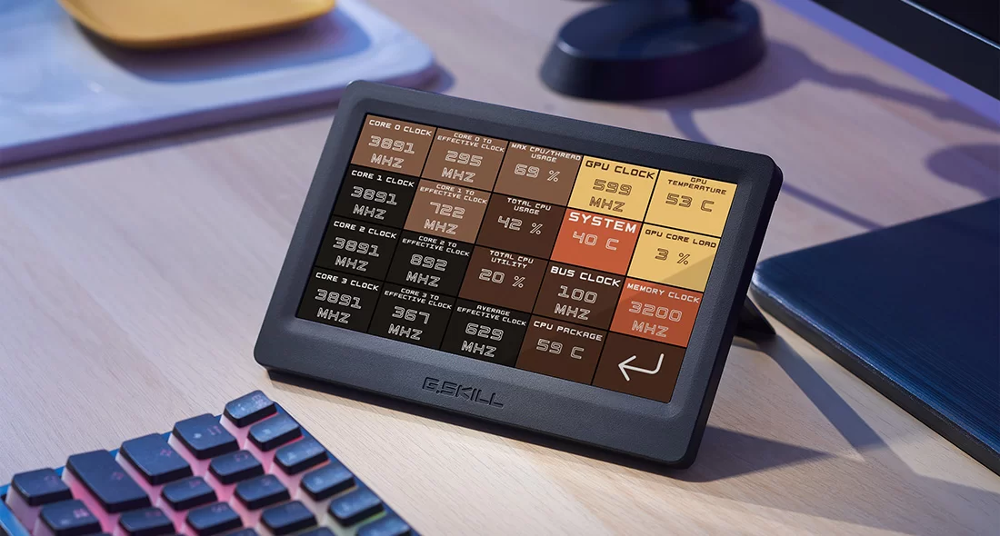
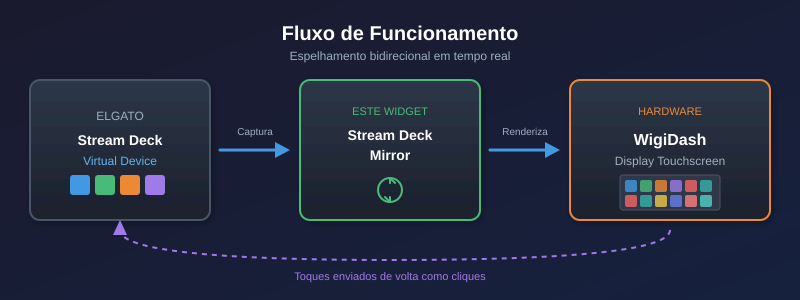
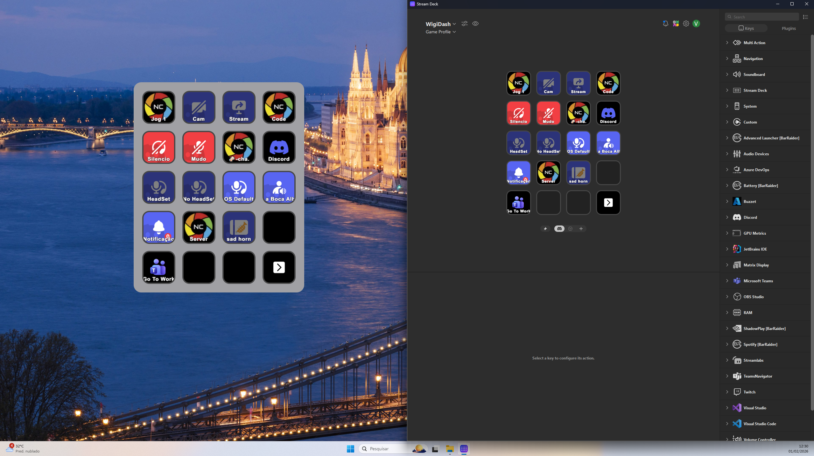
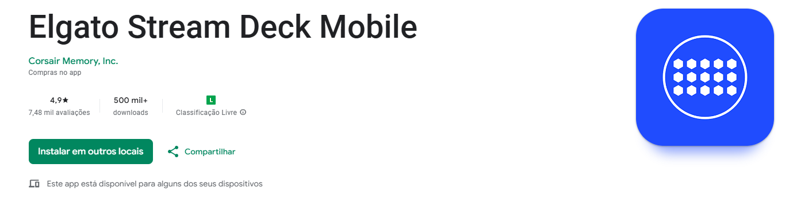
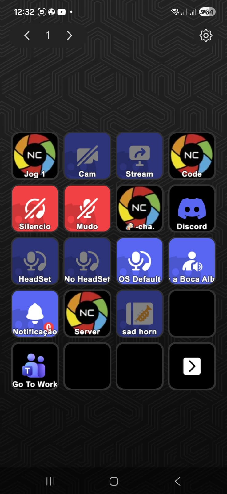
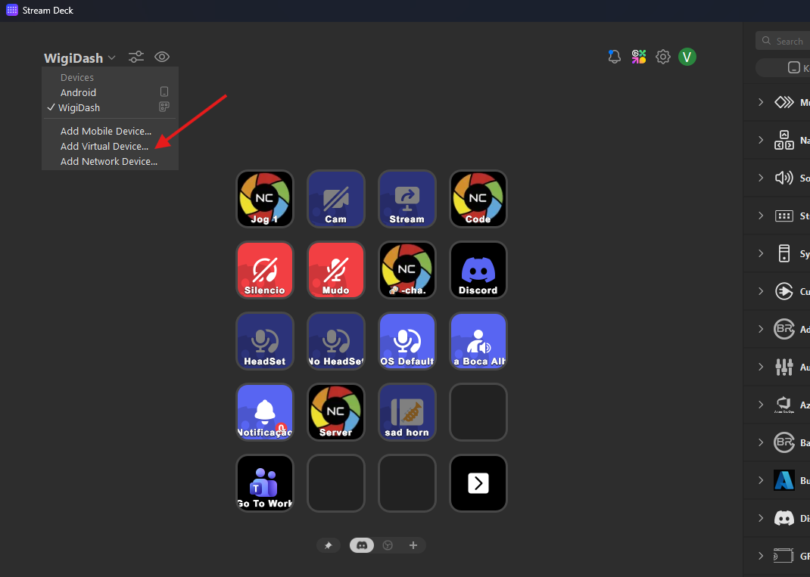
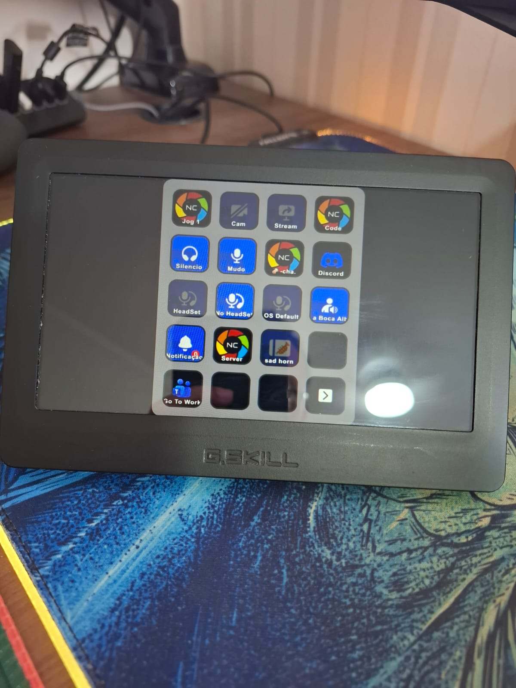

# Stream Deck Mirror para o WigiDash (OpenWigiDashManager)

[](https://github.com/victorperez2911/WigiDash-StreamDeckMirror-WidGet/actions/workflows/release.yml)

Plugin que espelha um Virtual Device do Elgato Stream Deck no painel WigiDash da G.SKILL, no
[OpenWigiDashManager](https://github.com/victorperez2911/OpenWigiDashManager) (.NET 10). Os toques no
WigiDash viram cliques no Stream Deck.

Esta é a branch `net10` (versões 2.x). A versão para o manager oficial da G.SKILL (net472) continua na
branch `main`.



---

## Sumário

- [O que é o WigiDash?](#o-que-é-o-wigidash)
- [Motivação](#motivação)
- [O que o widget faz](#o-que-o-widget-faz)
- [Requisitos](#requisitos)
- [Licenciamento Elgato - Virtual Devices](#licenciamento-elgato---virtual-devices)
- [Instalação](#instalação)
- [Configuração](#configuração)
- [Uso](#uso)
- [Solução de problemas](#solução-de-problemas)
- [Desenvolvimento](#desenvolvimento)
- [Publicar uma versão](#publicar-uma-versão)

---

## O que é o WigiDash?

O **WigiDash** é um painel touchscreen USB da G.SKILL (1016x592) que vai no gabinete ou na mesa e mostra
widgets. O manager oficial foi descontinuado; o [OpenWigiDashManager](https://github.com/victorperez2911/OpenWigiDashManager)
é o substituto em .NET 10, com plugins em pacotes do nuget.org, long-press e suporte a vários usuários do Windows.



---

## Motivação

O **Elgato Stream Deck** é uma ferramenta poderosa para streamers, criadores de conteúdo e usuários avançados.
Porém, ter vários dispositivos físicos na mesa é caro e ocupa espaço. Este widget usa a tela do WigiDash como
espelho de um Stream Deck Virtual: você mantém tudo o que o Stream Deck faz, mas vê e toca no WigiDash.



---

## O que o widget faz

Captura a janela do Virtual Device do Stream Deck e desenha no WigiDash em tempo real. Os toques voltam para a
janela como cliques.

```
┌─────────────────────┐     ┌──────────────────────┐     ┌─────────────────┐
│  Stream Deck App    │────▶│  Este widget         │────▶│  WigiDash       │
│  (Virtual Device)   │     │  (captura + espelho) │     │  (tela)         │
└─────────────────────┘     └──────────────────────┘     └─────────────────┘
         ▲                            │
         └────────────────────────────┘
              toques viram cliques
```

- Espelhamento em tempo real, de 1 a 20 quadros por segundo.
- Tap = clique; long-press = clique direito, com o rodapé enchendo enquanto o dedo segura.
- Vários Virtual Devices: cada instância do widget escolhe o seu.
- Esconde a janela original no monitor (ela continua existindo, só invisível).
- Mostra o estado quando não há imagem: Stream Deck fechado, Virtual Device não encontrado, erro de captura.
- Qualquer tamanho da grade, de 1x1 a 5x4.

---

## Requisitos

- Windows 10 (1607 ou mais novo) ou 11.
- [Elgato Stream Deck](https://www.elgato.com/downloads) 6.0 ou mais novo, com licença de Virtual Devices
  (veja abaixo).
- [OpenWigiDashManager](https://github.com/victorperez2911/OpenWigiDashManager) instalado pelo
  `OpenWigiDash-Setup.exe` da [release](https://github.com/victorperez2911/OpenWigiDashManager/releases) dele.
  O instalador já traz o .NET 10 que o manager usa.
- O aparelho WigiDash é opcional: sem ele, ligue o **WigiDash virtual** em **Ajustes > Aparelho ativo** do
  manager e use o widget pela prévia, com o mouse no lugar do dedo.

---

## Licenciamento Elgato - Virtual Devices

> **Importante:** Os Virtual Devices do Stream Deck requerem uma licença válida da Elgato.

### O que são Virtual Devices?

Virtual Devices são Stream Decks "virtuais" que aparecem como janelas no Windows. Eles oferecem a mesma funcionalidade de um Stream Deck físico, mas são renderizados em software.


<!-- SCREENSHOT: virtual-device-window.png - Print da janela do Virtual Device do Stream Deck no Windows -->

### Como obter a licença?

A Elgato libera Virtual Devices **apenas para quem possui um dispositivo Stream Deck registrado**. Existem duas formas:

#### Opção 1: Comprar um Stream Deck físico

Qualquer modelo de Stream Deck físico (Mini, MK.2, XL, Plus, Pedal) desbloqueia os Virtual Devices permanentemente.

#### Opção 2: Stream Deck Mobile (Recomendado para este uso)

O **Stream Deck Mobile** é um aplicativo para smartphones (Android/iOS) que funciona como um Stream Deck. Ele é **significativamente mais barato** que os dispositivos físicos e também desbloqueia os Virtual Devices!

[](https://play.google.com/store/apps/details?id=com.corsair.android.streamdeck&hl=pt-BR)

📲 **Download:** [Stream Deck Mobile na Google Play](https://play.google.com/store/apps/details?id=com.corsair.android.streamdeck&hl=pt-BR)

**Preço aproximado:** ~R$ 25-50/ano (assinatura) ou compra única em promoções

### O Truque da Conexão Mensal

> **Dica importante para usuários do Stream Deck Mobile!**

A Elgato verifica periodicamente se você ainda possui um dispositivo válido. Para manter os Virtual Devices funcionando com o Stream Deck Mobile:

1. **Conecte seu smartphone com o app Stream Deck Mobile ao PC pelo menos uma vez por mês**
2. O aplicativo no celular deve estar aberto e conectado ao Stream Deck Software no PC
3. Após a conexão ser estabelecida, os Virtual Devices continuarão funcionando por mais ~30 dias


<!-- SCREENSHOT: mobile-connection.png - Print mostrando o Stream Deck Mobile conectado ao PC (tela do app ou do software mostrando o device mobile) -->

**Fluxo recomendado:**

```
Dia 1 do mês:
  1. Abra o Stream Deck no PC
  2. Abra o Stream Deck Mobile no celular
  3. Conecte ao PC via WiFi
  4. Aguarde aparecer "Connected"
  5. Pronto! Virtual Devices liberados por mais 30 dias
```

---

## Instalação

O plugin é um pacote do nuget.org, `victorperez2911.OpenWigiDash.StreamDeckMirror` (tipo `OpenWigiDashPlugin`).
A loja de plugins dentro do manager ([OpenWigiDashManager#47](https://github.com/victorperez2911/OpenWigiDashManager/issues/47))
e o `owd plugin` ([#46](https://github.com/victorperez2911/OpenWigiDashManager/issues/46)), que vão instalar a
partir de lá, ainda estão planejados. Por enquanto:

1. Baixe o zip `OpenWigiDash-StreamDeckMirrorWidget-v2.x.zip` da última
   [release](https://github.com/victorperez2911/WigiDash-StreamDeckMirror-WidGet/releases).
2. Feche o manager pela bandeja.
3. Copie o conteúdo da pasta do zip para
   `%LOCALAPPDATA%\OpenWigiDash\Widgets\victorperez2911.OpenWigiDash.StreamDeckMirror\`
   (a mesma pasta que o `deploy.ps1` e a futura loja usam) e abra o manager de novo.

O ícone do pacote (`icon.png`) é o desenho do widget com o selo do OpenWigiDash no canto, o padrão dos
plugins oficiais.

---

## Configuração

### Passo 1: criar um Virtual Device

1. Abra o software **Elgato Stream Deck**.
2. Clique no ícone de dispositivos (canto superior direito).
3. Selecione **"Add Virtual Stream Deck"**.
4. Escolha o layout (ex.: 5x3, como o Stream Deck padrão).



### Passo 2: adicionar o widget

1. No OpenWigiDashManager, na tela **Widgets e páginas**, clique em adicionar widget.
2. Escolha **Stream Deck Mirror** e o tamanho.
3. Selecione o widget na grade: as configurações aparecem no painel ao lado.
4. Em **Virtual Device**, escolha a janela do Stream Deck (o botão de atualizar procura de novo).

### Opções

| Opção | O que faz |
|-------|-----------|
| **Virtual Device** | Qual janela do Stream Deck é espelhada |
| **Atualização** | Intervalo de captura, de 50 ms (20 quadros por segundo) a 1000 ms |
| **Esconder a janela do Stream Deck no PC** | Deixa a janela original invisível no monitor |
| **Mostrar o rodapé** | Barra de status embaixo; tocar nela mostra ou esconde a janela original |
| **Double tap nas faixas pretas** | Mostra ou esconde a janela original |
| **Cor das faixas** | Cor das faixas que sobram quando a proporção do widget não é a do Stream Deck |

---

## Uso

- **Tap nos botões:** clique no Stream Deck, que dispara a ação configurada.
- **Long-press:** clique direito. O rodapé enche enquanto o dedo segura (o tempo é o do manager, 600 ms).
- **Tap no rodapé:** mostra ou esconde a janela original.
- **Double tap nas faixas pretas:** mostra ou esconde a janela original (se ligado).



Quando não há imagem, o widget mostra o motivo, e o painel de configurações também:

| Estado | Significado |
|--------|-------------|
| **Conectado** | Funcionando |
| **Conectado (janela escondida)** | Funcionando, com a janela original invisível |
| **Stream Deck não está aberto** | O software da Elgato não está rodando |
| **Virtual Device não encontrado** | O Virtual Device escolhido não existe mais; o widget tenta reconectar |
| **Erro ao capturar a janela** | A captura falhou; o widget tenta de novo |
| **Escolha um Virtual Device** | Nenhum dispositivo escolhido ainda |

---

## Solução de problemas

### "Stream Deck não está aberto"

- Abra o software Elgato Stream Deck. Ele pode ficar minimizado na bandeja.

### "Virtual Device não encontrado"

- O Virtual Device pode ter sido removido. Escolha outro nas configurações (o botão de atualizar refaz a lista).

### Toques não viram cliques

- Confira se a janela do Virtual Device não está minimizada.
- Com "Esconder a janela", a janela precisa existir (só fica invisível).
- Reinicie o software do Stream Deck.

### Captura cortada ou cliques no lugar errado

- Acontece quando o DPI da janela muda (tela cheia exclusiva, monitor duplicado). Veja
  [docs/dpi-troubleshooting.md](docs/dpi-troubleshooting.md) e os scripts `scripts/Test-WindowCapture.ps1` e
  `scripts/Test-ClickDpi.ps1`.

### Virtual Devices não aparecem no Stream Deck

- Confira a licença da Elgato (seção de licenciamento) e conecte o Stream Deck Mobile se for a sua forma de licença.
- Reinicie o software do Stream Deck depois de conectar.

### Lento

- Aumente o intervalo de atualização (ex.: 100 ms).
- Virtual Devices menores consomem menos.

---

## Desenvolvimento

Precisa do SDK do .NET 10. O contrato dos widgets é o pacote `victorperez2911.OpenWigi.Sdk` (2.0.0-preview.3);
a referência para autores de plugins é o
[docs/sdk.md](https://github.com/victorperez2911/OpenWigiDashManager/blob/main/docs/sdk.md) do OpenWigiDashManager.

```powershell
.\deploy.ps1 -RestartManager                 # build e cópia para a pasta de widgets do usuário
dotnet pack -c Release                       # gera o pacote de plugin (.nupkg)
scripts\Test-PluginPackage.ps1               # confere o que foi para dentro do .nupkg
```

Não precisa do aparelho para desenvolver: com o WigiDash virtual ligado no manager (Ajustes > Aparelho ativo),
o `deploy.ps1 -RestartManager` reabre o manager no tray; abra a janela, adicione o widget e use "Destacar
prévia", onde o mouse vira toque (clicar dá tap, segurar dá long-press).

Para testar contra o SDK local em vez do pacote do nuget.org, compile com `-p:UseLocalOpenWigiSdk=true` e o
repositório OpenWigiDashManager clonado ao lado deste.

| Arquivo | O que é |
| --- | --- |
| `StreamDeckMirrorWidget.cs` | Ficha do widget (manifesto, tamanhos, ícone do assistente) |
| `StreamDeckMirrorWidgetInstance.cs` | Instância na tela: captura, quadros, toques |
| `StreamDeckMirrorSettings.razor` | Tela de configurações (MudBlazor) dentro do manager |
| `WindowCapture.cs`, `DpiScope.cs`, `NativeMethods.cs` | Captura da janela e cliques, com o DPI certo |
| `DeviceIdentification.cs` | Acha as janelas dos Virtual Devices |
| `StateRenderer.cs`, `FooterBarRenderer.cs`, `AspectRatioHelper.cs` | Telas de estado, rodapé e encaixe |

---

## Publicar uma versão

Crie a tag `v<versão>` (ex.: `v2.1.0-preview.1`, a primeira publicada no nuget.org) no branch `net10`. O workflow `release.yml` publica o pacote no
nuget.org por Trusted Publishing e cria a release do GitHub com o zip. Enquanto o SDK for preview, a versão do
plugin também precisa ser preview.

---

## Créditos

- **WigiDash** - G.SKILL
- **Elgato Stream Deck** - [elgato.com](https://www.elgato.com/stream-deck)
- Desenvolvido com auxílio do Claude
